# Module Two - Data Three Ways

*Decoupling or outsourcing? Growth, carbon and trade in six economies, 1990-2022*

**Course:** Applied Computer Vision / Data Visualization (Module Two)  
**Assignment:** Module Two - Data Three Ways  
**Student:** Taher Turki  
**Date:** October 2026

---

## 1. Central Narrative and Data Description

### 1.1 The question

**Has economic growth in post-industrial nations genuinely decoupled from carbon emissions, or have wealthy countries merely outsourced their environmental footprint by importing emissions-intensive manufactured goods from developing nations?**

These two explanations predict very different patterns when we compare how emissions are counted. A country's CO2 can be measured where fossil fuels are physically burned--known as production-based or territorial accounting--or where finished goods and services are ultimately consumed, known as consumption-based accounting. If a wealthy economy reduced its domestic emissions simply by shifting heavy manufacturing overseas, its consumption-based emissions would remain flat or continue climbing even as its territorial emissions fell, widening the gap between the two accounts over time. Conversely, if economic growth has genuinely decoupled from carbon, both territorial and consumption-based emissions should decline together. Every visualization in this report examines this relationship across three core quantities for each country and year: real GDP per person, CO2 per person under both accounting methods, and the net trade balance between the two accounts.

Looking across the full 1990-2022 record, the data show that both dynamics occurred in sequence, though on different scales. Between 1990 and 2007, the outsourcing hypothesis holds up well for the United Kingdom and the United States. During that period, the United Kingdom's territorial CO2 per person fell by 13% while its consumption-based footprint rose by 7%, causing the net import gap between the two series to triple from 1.1 t to 3.3 t per person. After 2007, however, both series declined in tandem. Over the entire 33-year window, GDP per person across the four high-income economies tracked in this study grew by 46% to 84%, while their consumption-based CO2 per person fell by 18% to 52%--a sustained reduction that offshoring alone cannot explain. What offshoring leaves behind is a persistent baseline gap and a reporting bias: in 2022, the United Kingdom's consumption footprint was 62% higher than its domestic territorial emissions, and territorial accounting suggests a 57% reduction since 1990 compared to a 36% reduction on the consumption account.

### 1.2 The dataset

All data in this report come from the Our World in Data (OWID) CO2 and Greenhouse Gas Emissions dataset (Ritchie et al., 2023), a CSV of 50,411 rows and 79 columns covering 254 countries and regional aggregates from 1750 to 2024. The snapshot analyzed here was retrieved on 4 October 2026 from `https://owid-public.owid.io/data/co2/owid-co2-data.csv`. To ensure reproducibility, `scripts/fetch_inputs.py` verifies the local file against its stored SHA-256 checksum prior to running the pipeline. Because OWID compiles this file from primary institutional datasets, Table 1 cites each upstream authority alongside its respective coverage and units.

| Variable | What it measures | Unit | Upstream source | In the file for |
| :--- | :--- | :--- | :--- | :--- |
| `gdp` | Real GDP, adjusted for inflation and purchasing power differences across countries | international-$ at 2011 prices | Maddison Project Database 2023 (Bolt & van Zanden, 2025) | 1820-2022 |
| `population` | Resident population | persons | World Population Prospects 2024 (United Nations, 2024), via OWID (Mathieu & Rodés-Guirao, 2022) | 1750-2024 |
| `co2_per_capita` | Production-based (territorial) CO2 from fossil fuels and industry; excludes land-use change | t per person per year | Global Carbon Budget 2025 (Friedlingstein et al., 2026; Andrew & Peters, 2025) | 1750-2024 |
| `consumption_co2_per_capita` | Territorial CO2 minus CO2 embodied in exports, plus CO2 embodied in imports | t per person per year | Global Carbon Budget 2025, method of Peters, Minx, et al. (2011) | 1990-2023 |
| `cumulative_co2` | Territorial CO2 summed continuously from 1750 | Mt | Global Carbon Budget 2025 | 1750-2024 |
| `income group` | World Bank classification by GNI per capita for FY 2027, consolidated into three tiers | category | World Bank (2026) | current year only |

From these raw columns, `scripts/prepare_data.py` derives three analytical variables:

```text
gdp_per_capita     = gdp / population                               international-$ per person
net_co2_per_capita = consumption_co2_per_capita - co2_per_capita    t CO2 per person
net_co2_mt         = consumption_co2 - co2                          Mt CO2
```

The net balance (`net_co2_per_capita`) is the central metric of our analysis. A positive balance means a country consumes more CO2 than it emits domestically, making it a net importer of embodied emissions; a negative balance means it emits more domestically than it consumes, making it a net exporter.

**Sampling and Panel Construction.** All series are annual, covering the 33-year window from 1990 to 2022--the overlapping period where consumption-based CO2 estimates (which begin in 1990) and Maddison real GDP data (which end in 2022) are jointly available. Out of 218 sovereign entities with an ISO code, 115 have complete records for GDP, population, and both CO2 series across all 33 years. Five of those countries contain unmodeled placeholder values in early years (detailed below) and are excluded rather than interpolated, leaving a balanced panel of 110 countries. Six focal economies anchor the narrative and appear in a consistent sequence across every chart: the United States, the United Kingdom, Germany, and Sweden (high income), alongside China (upper-middle income) and India (lower-middle income). The remaining 104 countries provide global context in Visualization 1, where 109 of the 110 countries carry an official World Bank income classification (Taiwan is omitted from the World Bank API response).

| Country | GDP per person, int-$ | Production CO2, t per person | Consumption CO2, t per person | Net balance, t per person | Share of world cumulative CO2 |
| :--- | :--- | :--- | :--- | :--- | :--- |
| **United States** | 36,509 to 57,075 (+56%) | 20.25 to 14.80 (-27%) | 19.94 to 16.30 (-18%) | -0.32 to +1.49 | 24.0% |
| **United Kingdom** | 26,246 to 38,358 (+46%) | 10.49 to 4.56 (-57%) | 11.61 to 7.37 (-36%) | +1.12 to +2.81 | 4.5% |
| **Germany** | 25,287 to 46,495 (+84%) | 13.23 to 7.94 (-40%) | 15.06 to 9.98 (-34%) | +1.82 to +2.03 | 5.3% |
| **Sweden** | 28,069 to 47,125 (+68%) | 6.71 to 3.47 (-48%) | 13.11 to 6.33 (-52%) | +6.40 to +2.86 | 0.3% |
| **China** | 2,934 to 18,921 (+545%) | 2.15 to 8.22 (+282%) | 2.05 to 7.32 (+258%) | -0.11 to -0.90 | 14.7% |
| **India** | 2,024 to 7,350 (+263%) | 0.67 to 1.99 (+197%) | 0.67 to 1.64 (+143%) | +0.01 to -0.34 | 3.4% |

Each cell in Table 2 compares 1990 against 2022. The final column lists each nation's share of cumulative global territorial CO2 emitted since 1750 as of 2022, underscoring the historical scale of the United States, which alone accounts for nearly a quarter of all historical industrial emissions.

### 1.3 Data integrity

Interpreting these series accurately requires accounting for eight methodological constraints in the underlying data:

1. **Consumption emissions are modeled estimates.** The Global Carbon Budget estimates consumption-based CO2 using a multi-region input-output (MRIO) trade model anchored to Global Trade Analysis Project (GTAP) benchmark tables for seven reference years (1997, 2001, 2004, 2007, 2011, 2014, and 2017) and extrapolated to intervening and subsequent years using national GDP and trade accounts (Friedlingstein et al., 2026, Supplement S.1.2). Because no benchmark table exists after 2017, the final five years of our panel rely on trade-model extensions, and the Global Carbon Project does not publish separate uncertainty bounds for the consumption series.
2. **Placeholder records in early consumption series.** In 39 country-years, the raw file repeats the territorial figure verbatim in the consumption column to six significant digits: Belgium and Luxembourg through 1998, South Africa and Botswana through 1999, and Tunisia in 2021. This produces an artificial net balance of zero that jumps abruptly once trade modeling begins (for example, Belgium jumps from 0 to +56 Mt in 1999). Because no genuine modeled balance in the dataset falls within 0.00001 of zero, `scripts/prepare_data.py` flags any observation where the two accounts match within one part in 100,000 as missing and excludes those five incomplete countries from the panel.
3. **Emissions scope.** Both series track CO2 from fossil fuel combustion and cement production. Emissions from land-use change, forestry, methane, and nitrous oxide are excluded, as are international aviation and maritime bunker fuels, which are not allocated to national territories.
4. **Differences across GDP series.** The OWID CO2 file bundles Maddison Project GDP measured in 2011 international dollars. By contrast, the interactive chart in the original OWID article plots a World Bank PPP series in 2021 prices, under which UK GDP per person grows by 61% between 1990 and 2022 compared to 46% in the Maddison series. Both charts share identical CO2 series to five decimal places, meaning the emissions side of the decoupling calculation is unchanged while the magnitude of income growth depends on the chosen price benchmark. Additionally, dividing Maddison total GDP by OWID's UN population column yields a US per-capita GDP increase of 56.3% (versus 58.2% in Maddison's internal per-capita series) and 263% for India (versus 272%), while the remaining four focus nations agree within 0.6 percentage points.
5. **Geopolitical accounting anomalies.** Kuwait's territorial emissions spike from 38 Mt in 1990 to 493 Mt in 1991 due to the Gulf War oil-well fires, which OWID merges into Kuwait's territorial total (Andrew & Peters, 2025). Because the trade model does not allocate oil-fire emissions to foreign consumers, Kuwait registers as a net exporter of 473 Mt in 1991, pulling the entire high-income group's aggregate balance down from +461 Mt to -12 Mt for that single year. I retain the observation in the panel and annotate the anomaly where relevant.
6. **Fixed contemporary income classifications.** World Bank income tiers reflect the fiscal year 2027 classification (effective July 2026) applied across the full 1990-2022 timeframe. Although China was classified as a low-income economy in 1990, it is encoded under its current upper-middle-income designation throughout the scatterplots.
7. **Single-year baseline sensitivity.** Using 1990 as an index anchor introduces single-year noise for Germany (which reunified in October 1990) and Sweden (whose 1990 consumption estimate of 13.1 t is nearly double its territorial figure of 6.7 t). To mitigate endpoint sensitivity, I pair single-year comparisons with ten-year window averages in Visualization 1.
8. **Incomplete coverage of lower-income economies.** Because the panel of 110 countries is restricted to nations continuously tracked by the trade model across all 33 years, smaller developing economies are underrepresented; only 7 of the 110 countries fall into the low-income tier.

As an internal consistency check, the net balance derived in `scripts/prepare_data.py` matches OWID's precomputed `trade_co2` column to within 0.0005 Mt across every row of the 3,630 country-year observations, confirming that the difference between consumption and production per-capita series accurately captures embodied trade flows.

### 1.4 Tools and AI use

The project pipeline is implemented in Python 3.12 using `pandas` 3.0, `altair` 6.3, `matplotlib` 3.11, and `seaborn` 0.13 inside a local virtual environment, paired with vanilla JavaScript and D3 v7 for web rendering. Course guidelines permit AI assistance on at most one target visualization. I used that allowance for **Visualization 2**, the D3.js connected scatterplot: AI tooling (Claude, Anthropic) worked there as a coding assistant and nowhere else. Visualization 1 (Altair), Visualization 3 (Seaborn/Matplotlib), the data preparation scripts, and the written analysis in this report were completed independently by me without AI assistance. Specific implementation disclosures appear at the end of Sections 3, 4, and 5.

## 2. Story Remix Context

### 2.1 The original story

**Citation:** Ritchie, H. (2021, December 1). *Many countries have decoupled economic growth from CO2 emissions, even if we take offshored production into account*. Our World in Data. https://ourworldindata.org/co2-gdp-decoupling

Ritchie addresses the exact question posed in this report and summarizes her argument in 418 words and three charts. She makes a two-part claim: first, that numerous wealthy nations have expanded GDP while reducing domestic CO2 emissions; second, that this decline is not merely an accounting artifact of globalization--stating that *"it would be wrong to assume that this reduction in emissions in rich countries was only achieved by offshoring production overseas"* because consumption-based emissions *"have also fallen"* (Ritchie, 2021). Because the body text of her article cites no specific numbers, the visual encodings carry the entire empirical burden. Below, I evaluate the article as served on 4 October 2026 under its Creative Commons BY license.

**Chart A: The indexed line chart (Figure 1).** The article opens with an interactive Our World in Data Grapher embed titled *"Change in per capita CO2 emissions and GDP"*, defaulting to the United Kingdom. It plots three continuous line series with annual point markers from 1990 onward. Horizontal position encodes the year, while vertical position on a shared scale (-60% to +60%) encodes cumulative percentage change relative to 1990 for GDP per capita, consumption-based CO2 per capita, and territorial CO2 per capita. Color hue distinguishes the three series, which are directly labeled at their right endpoints. Interactive controls allow readers to switch or add countries and adjust the date range. Later in the article, Ritchie embeds the same chart a second time configured as a six-country small-multiple grid sharing a common percentage axis.

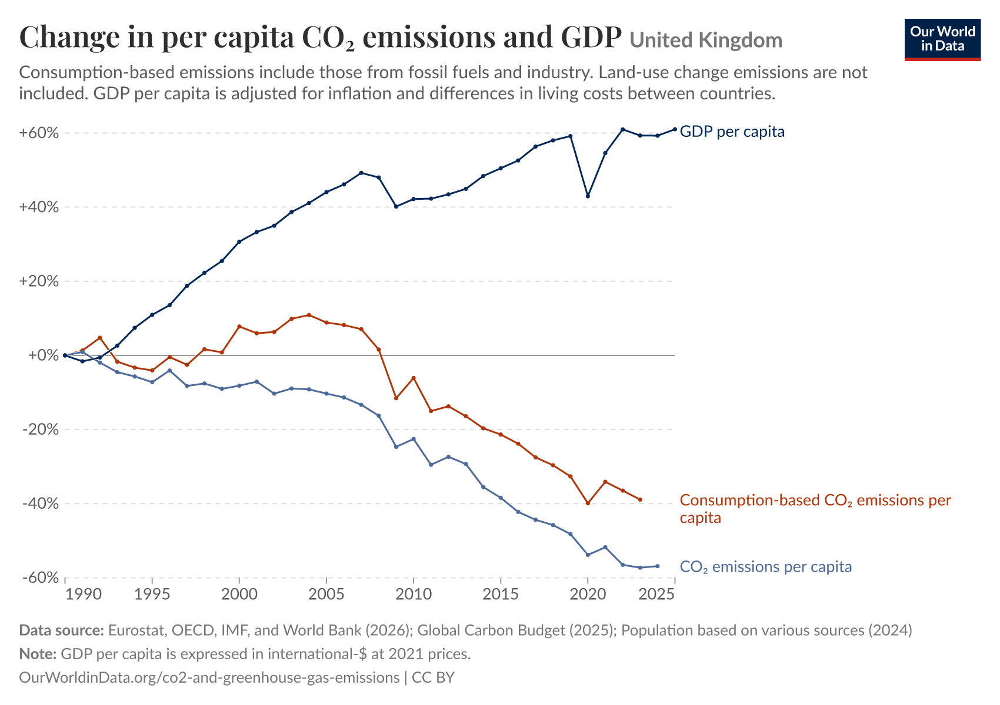

*Figure 1 - The original, Chart A: "Change in per capita CO2 emissions and GDP", United Kingdom, percent change since 1990. This is the export served on 4 October 2026, so it runs past the 2021 article; its GDP line is a World Bank series at 2021 prices. Source: Our World in Data, CC BY; reproduced unaltered from https://ourworldindata.org/co2-gdp-decoupling.*

**Chart B: The static arrow grid (Figure 3).** The second idiom is a static graphic credited to Max Roser titled *"Decoupling: Countries that achieved economic growth while reducing CO2 emissions, 2005-20"*. It arranges 30 country panels in a 5 x 6 grid. Within each panel, two straight arrows diverge from a common left-hand origin: a blue arrow pointing upward to represent percentage growth in GDP per capita, and a red arrow pointing downward to represent percentage reduction in consumption-based CO2 per capita between 2005 and 2020.

### 2.2 Critique of the original charts

Both original visualizations are clean, well-labeled, and transparent about their data sources, and Chart A's horizontal zero baseline makes the divergence between positive GDP growth and negative emissions growth immediately legible. However, the two idioms suffer from five analytical limitations when evaluating the trade-outsourcing question:

1. **Absolute emission levels are hidden.** Because every series is indexed to 0% in 1990, physical quantities in tonnes disappear entirely. In Figure 1, the United Kingdom's production and consumption lines both start at the exact same 0% origin in 1990, hiding the fact that the UK was already importing a net balance of 1.12 t of CO2 per person in 1990. Readers can only compare differences in relative percentage rates rather than the physical tonnage of offshored carbon, and the embedded chart disables the toggle that would display absolute units.
2. **Indexed percentage scales break down when comparing advanced and developing economies.** When I used Chart A's country selector to add China alongside the United Kingdom (Figure 2), the view split into faceted panels sharing a vertical axis that stretched to +1,500% to accommodate China's tenfold GDP expansion from a low 1990 base. On that shared scale, the United Kingdom's entire 33-year trajectory (-57% to +61%) is compressed into a flat sliver along the zero line. As a result, the idiom cannot legibly compare a wealthy net importer and a rapidly industrializing net exporter on the same axis.

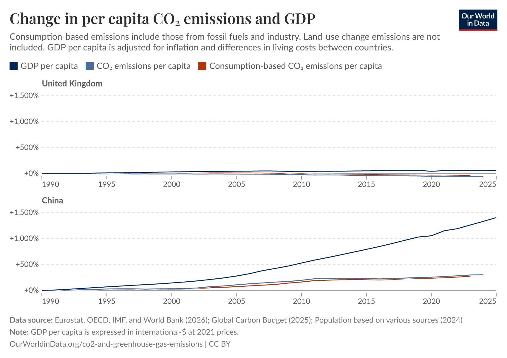

*Figure 2 - Chart A after adding China with its own country control. The chart splits into one panel per country on a shared percent axis that runs to +1,500%, and the United Kingdom's three lines collapse onto the zero line. Source: Our World in Data, CC BY; reproduced unaltered from https://ourworldindata.org/co2-gdp-decoupling.*

3. **Income and emissions are never plotted directly against each other.** Because time occupies the horizontal axis in Chart A, evaluating how emissions respond to economic growth requires the viewer to visually estimate and compare the slopes of separate lines over time. In Cleveland and McGill's (1984, p. 536) hierarchy of graphical perception, slope and angle judgments are significantly less accurate than judgments of position along a common scale.
4. **Reliance on two isolated endpoints--ending in a pandemic anomaly.** Chart B (Figure 3) collapses sixteen years of economic history into a single two-point comparison (2005 versus 2020) and filters the dataset to show only countries where both metrics changed by more than 5%. Ironically, the United Kingdom--the flagship example of Ritchie's article--is missing from the 30 panels because UK real GDP per capita in 2020 dipped 0.8% below its 2005 level due to COVID-19 lockdowns (whereas ending in 2019 would show +10.5% growth). Similarly, UK consumption-based CO2 dropped 10.8% in 2020 alone before rebounding 9.6% in 2021. By filtering strictly for decoupling successes, the grid also omits net exporters like China and India and provides no visibility into international trade balances.

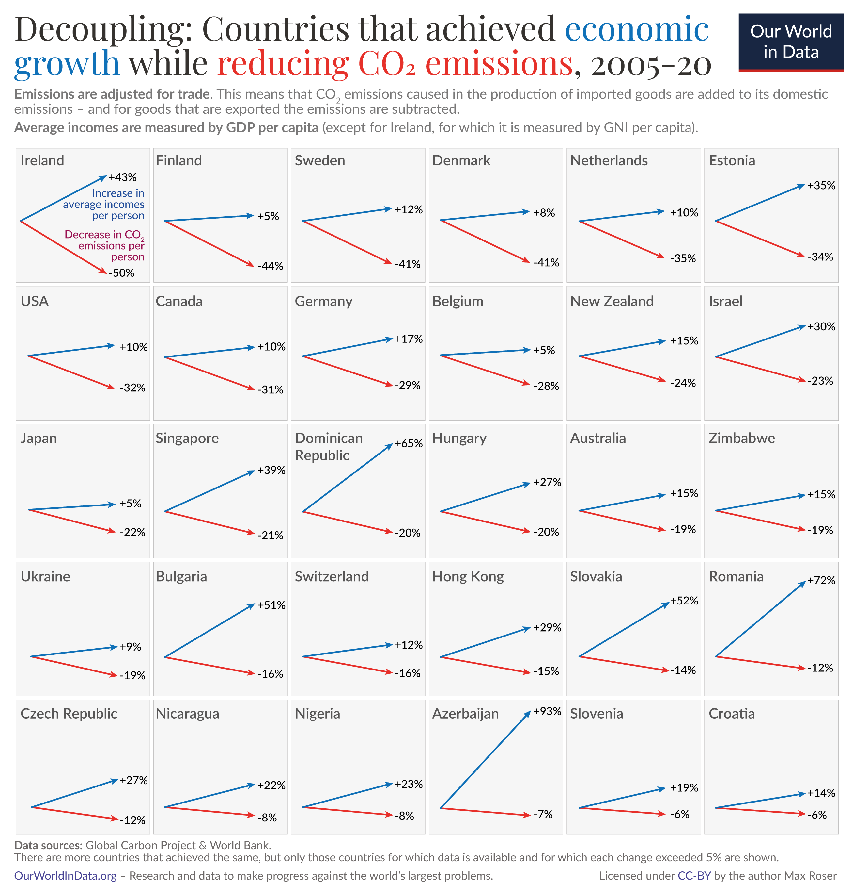

*Figure 3 - The original, Chart B: a static grid of 30 countries, each as two arrows for the change in GDP per capita and in consumption-based CO2 per capita between 2005 and 2020. The United Kingdom is not among them. Image credited to Max Roser. Source: Our World in Data, CC BY; reproduced unaltered from https://ourworldindata.org/co2-gdp-decoupling.*

5. **Limited interactive agency.** While Chart A lets readers swap countries or narrow the year range, the views are isolated. A reader cannot brush a specific historical era (such as the pre-2008 globalization boom) to see how global trade balances shifted across income groups, nor can they inspect how territorial and consumption trajectories diverge in phase space.

### 2.3 What the remix adds

| Limit of the original | What this report does about it |
| :--- | :--- |
| **Levels are gone** | Visualization 3 plots the trade gap directly in tonnes per person. Visualization 2 plots consumption footprints in tonnes against real income in dollars. |
| **No importer and exporter in one view** | All three visualizations place the United States, the United Kingdom, Germany, and Sweden alongside China and India on shared or compatible coordinate scales. |
| **GDP and CO2 never meet** | Visualization 2 maps GDP per person to the x-axis and CO2 per person to the y-axis, encoding time along the connected trajectory path. |
| **Two endpoints** | Every visualization incorporates all 33 annual observations (1990-2022), allowing readers to brush custom multi-year windows in Visualization 1 and scrub year-by-year in Visualization 2. |
| **Substitution only; no linked cross-country view** | Visualization 1 links the national time series to a 109-country scatterplot so brushing any time interval dynamically recomputes the global cross-section. |

Extending the panel through 2022 also incorporates two post-pandemic recovery years that were unavailable when the 2005-2020 arrow grid was published. As noted in Section 1.3, whereas OWID's Chart A uses World Bank GDP at 2021 prices, this remix uses the Maddison Project GDP series (at 2011 prices) bundled directly inside the OWID CO2 dataset.

## 3. Visualization 1 - Altair Linked Coordinated Views

### 3.1 The view

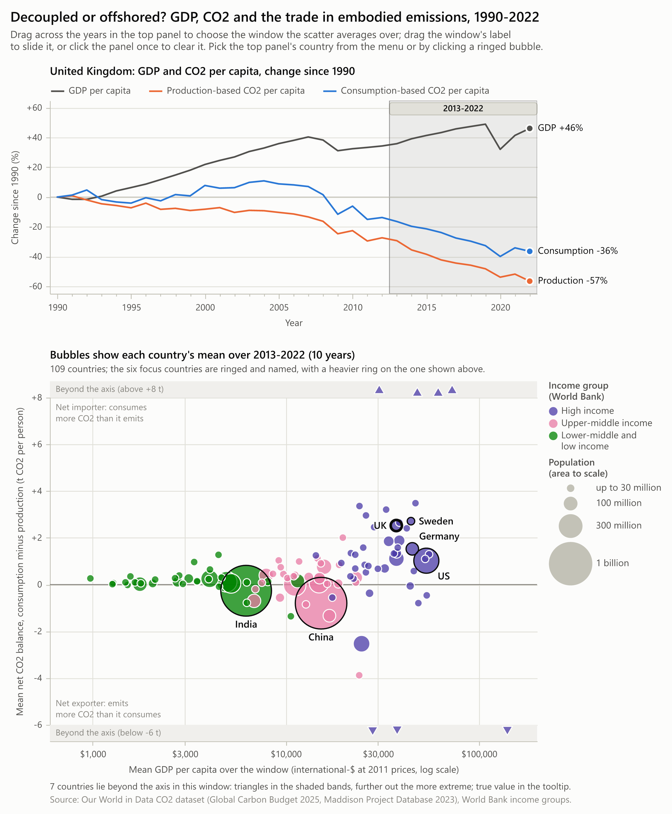

*Figure 4 - Visualization 1, static export with the brush on 2013-2022 and the United Kingdom in the top view. Top: percent change since 1990 in GDP per capita and in CO2 per capita on both accounts. Bottom: 109 countries at their means over the brushed years; x is GDP per capita on a log scale, y the net balance of embodied CO2, area is population and hue the World Bank income group. Seven countries lie beyond the axis and are drawn as triangles in the shaded bands.*

Visualization 1 provides a macro-level overview of the global trade in embodied carbon. It tests whether the generalization that wealthy nations import carbon while developing nations export it holds across the broader global panel, and how that distribution evolved between 1990 and 2022. The design pairs two coordinated views on a single canvas (Figure 4): the top panel reproduces the indexed time-series view from the original article for a selected focal country, while the bottom panel plots 109 countries by their average GDP per capita and average net CO2 trade balance across whichever time window the user brushes in the top panel.

### 3.2 Idiom, marks and channels

Following Munzner's (2014) taxonomy, the design pairs two juxtaposed, multiform views: the same underlying country-year panel is encoded simultaneously as a longitudinal time series and a cross-sectional bubble scatterplot, linked by an interactive temporal filter.

| Channel / Aspect | Top view: time series | Bottom view: scatter |
| :--- | :--- | :--- |
| **Items** | 33 years of 3 measures for one country | 109 countries, each averaged over the brushed years |
| **Mark** | 2 px line per measure | Point: a circle, or a triangle when its value lies beyond the y-axis |
| **Horizontal position** | Year, 1990 to 2022 | Mean GDP per person, log scale, $600 to $200,000 |
| **Vertical position** | Percent change since 1990, common scale | Mean net balance, linear, -6 to +8 t CO2 per person |
| **Hue** | Measure: grey for GDP, orange for production, blue for consumption | World Bank income group: violet, magenta, green |
| **Area** | Not used | Mean population |
| **Shape** | Not used | Circle inside the axis range, outward-pointing triangle beyond it |
| **Text** | The 2022 value at each line end | Names of the six focus countries; active window in the panel title |
| **Interaction** | Interval brush on x; hover crosshair; country menu | Re-averaged on every brush move; tooltip per bubble; click a ringed bubble |

**Prioritizing position for the primary comparison.** In the scatterplot, per-capita wealth and the net embodied CO2 balance are assigned to horizontal and vertical position on common scales--the highest-ranking perceptual channels for quantitative accuracy (Cleveland & McGill, 1984, p. 536). Because GDP per capita spans more than two orders of magnitude across the 109 countries (from $624 to $163,531), the x-axis uses a logarithmic transformation so equal horizontal steps represent equal multiplicative ratios and lower-income economies are not compressed against the left border. Conversely, because the net CO2 balance has a meaningful zero threshold separating net importers from net exporters, the y-axis is linear with an emphasized zero baseline and explicit directional annotations in both half-planes.

**Handling extreme outliers without distorting the main view.** A handful of small oil-exporting states and commercial entrepots exhibit extreme per-capita balances ranging from -38 t to +24 t per person. Allowing those outliers to dictate the vertical domain would compress the six focal economies into a narrow central band, while dropping them would censor valid observations. To resolve this, the y-axis is fixed to [-6, +8] t per person, and countries falling outside that interval are pinned as upward- or downward-pointing triangles inside shaded boundary bands labeled *"Beyond the axis"*, with their exact values preserved in hover tooltips and comparison captions. Across all 561 possible year windows, at most 8 of the 109 countries fall into the boundary bands, and the six focal countries remain well inside the main plotting area at all times.

**Encoding context via area and hue.** Population is mapped to bubble area--a lower-ranked channel appropriate for contextual weighting rather than exact lookup. Area scales linearly with population above 30 million, while smaller nations share a minimum diameter of 8 px inside a 1.2 px stroke so countries the size of Sweden remain easy to see and target. World Bank income tiers are encoded using three categorical hues (violet for high income, magenta for upper-middle, and green for lower-middle and low income). Because horizontal position already orders countries by GDP per capita, hue serves to highlight group clustering across the zero line. The three colors were verified under simulated protanopia and deuteranopia (Machado et al., 2009) to ensure clear visual separation for color-vision-deficient readers.

**Mark dimensions.** The top panel's lines are drawn at 2 px stroke width; in the scatter panel, bubble diameters range from the 8 px floor up to roughly 63 px for China and India inside an 822 px wide canvas.

### 3.3 The brush and the link

Becker and Cleveland (1987, p. 127) define brushing as dragging an interactive region across one view while the resulting operation updates all linked views simultaneously--specifically noting the utility of a narrow 1D brush that constrains one variable to an interval to inspect conditional behavior in another plot (p. 131). In `scripts/vis1_altair_linked.py`, the brush is defined as a 1D interval selection bound strictly to the horizontal year axis of the top panel:

```python
# scripts/vis1_altair_linked.py
    brush = alt.selection_interval(
        name="brush", encodings=["x"], zoom=False, clear=False,
        mark=alt.BrushConfig(fill=INK, fillOpacity=0.07, stroke=INK_2, strokeOpacity=0.55,
                             strokeWidth=1, cursor="ew-resize"), **start)
```

The bottom scatterplot consumes that interval selection as a live filter and aggregates the surviving rows by country on the fly:

```python
# scripts/vis1_altair_linked.py
    chart = chart.transform_filter(window_filter(window)).transform_aggregate(
        mean_gdp="mean(gdp_per_capita)", mean_net="mean(net_co2_per_capita)",
        mean_pop="mean(population)", n_years="count()", year_min="min(year)",
        year_max="max(year)", groupby=["country", "income_group", "is_focus"])
```

Altair compiles these declarations into a reactive Vega-Lite specification (Satyanarayan et al., 2017; VanderPlas et al., 2018) that executes entirely in the browser. As the user drags or resizes the shaded brush window across the timeline, every bubble in the scatterplot smoothly transitions to its recomputed window mean, and the lower panel's title dynamically updates to state the active year span (e.g., *"Bubbles show each country's mean over 2013-2022 (10 years)"*). Clicking once outside the brush resets the aggregation to the full 33-year average.

While coordinated views commonly rely on visual highlighting (Roberts, 2007, Section 4.1), dynamic re-averaging is far better suited to this dataset: plotting all 3,597 country-year points simultaneously would create severe overplotting, and multi-year window averaging smooths out the single-year accounting noise noted in Section 1.3. Coordination also operates in reverse: clicking any of the six ringed focal bubbles in the scatter--or choosing a country from the dropdown menu above the canvas--updates the top time-series panel to display that nation's historical record. Figure 5 shows the live view in Microsoft Edge after dragging the brush to the 2002-2008 WTO expansion era and selecting China.

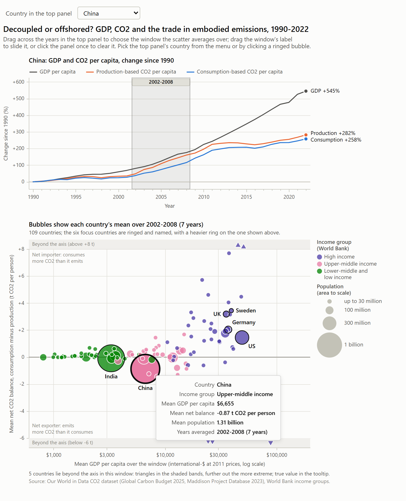

*Figure 5 - Browser capture of the live chart in Microsoft Edge, taken after the brush was dragged with the mouse to 2002-2008 and China was picked from the menu. The top view, the panel title, the bubbles and the tooltip (China, mean net balance -0.87 t over 2002-2008) all follow the selection.*

### 3.4 What it shows

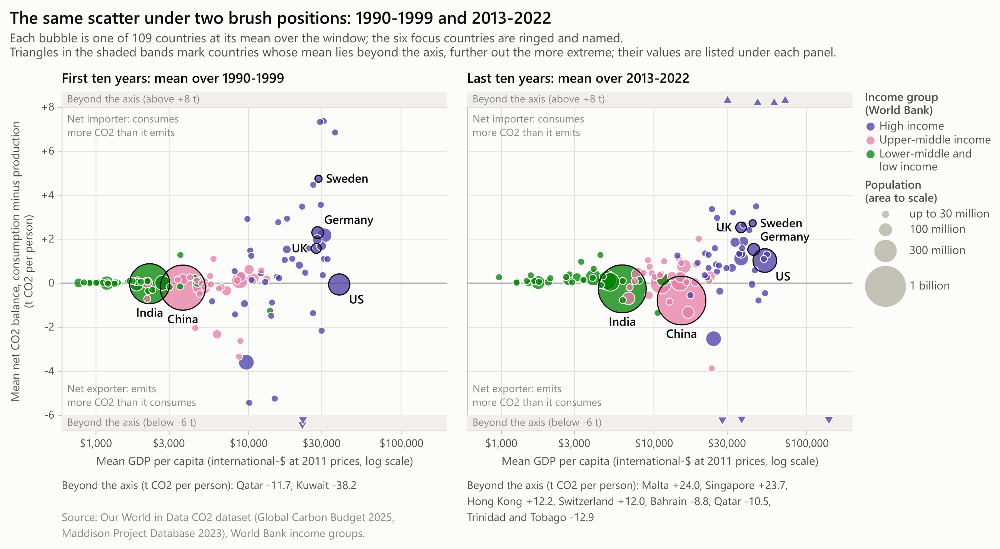

*Figure 6 - Comparison plate: the scatter under two brush positions. Left, each country's mean over 1990-1999; right, its mean over 2013-2022. The United Kingdom and the United States move up, Germany and Sweden move down, and China and India sink further below zero. Countries beyond the axis are listed under each panel with their true values.*

**High-income economies overwhelmingly sit on the importing side.** Comparing the first decade of the panel (1990-1999) against the final decade (2013-2022) in Figure 6 shows that 37 of the 46 high-income countries are net importers of embodied CO2 in the recent window, up from 33 in the 1990s. Over that span, the United Kingdom's ten-year average balance rose from +1.57 t to +2.53 t per person, while the United States crossed from a slight net exporter (-0.06 t) to a net importer (+1.02 t). However, rising import dependence was not universal among wealthy nations: Germany's mean balance narrowed from +2.30 t to +1.53 t, and Sweden's dropped from +4.74 t to +2.71 t.

**Net exporters are highly concentrated rather than representative of all developing nations.** In the 2013-2022 window, China (-0.79 t per person) and India (-0.26 t per person) sit clearly below the zero line as massive population bubbles. Yet surrounding them, the majority of middle- and lower-income countries actually sit slightly *above* zero as net importers: 22 of the 30 upper-middle-income countries and 28 of the 33 lower-income countries are net importers in 2013-2022 (up from 15 and 23 in the 1990s). Global carbon exporting is driven by a small number of manufacturing powerhouses and hydrocarbon exporters rather than developing countries as a whole, yielding a modest Spearman rank correlation between GDP per capita and net balance per person (r_s = 0.40 in 1990-1999 and 0.43 in 2013-2022).

**Aggregate flows align with established benchmarks.** Summing total tonnage across the high-income group shows net imported CO2 rising from 0.37 Gt in 1990 to 1.55 Gt in 2008, closely matching Peters, Minx, et al.'s (2011, p. 8903) benchmark estimates of 0.4 Gt and 1.6 Gt for those same years.

### 3.5 Implementation

The visualization is built in Altair 6.3 as a vertical concatenation (`alt.vconcat`) of two layered panels with independent color scales (822 x 995 px). The compiled output embeds the 3,597 scatter rows and 198 focus time-series rows directly into a self-contained HTML artifact (`web/altair_export.html`, 1.6 MB) alongside high-resolution static PNG exports. Nearest-point hover selections allow users to trigger tooltips without having to land precisely on a 2 px line stroke, though on the outer edges of the largest bubbles (China and India), the pointer can occasionally snap to a smaller adjacent country whose center lies closer to the cursor. To confirm numerical accuracy, the script cross-checks the browser's live aggregated state against independent `pandas` window averages across multiple brush positions (agreeing to within 1e-13 t).

**AI-use disclosure.** This visualization was designed, programmed, and verified independently by me in Altair (`scripts/vis1_altair_linked.py`) without AI assistance.

Source files for this section: `scripts/vis1_altair_linked.py`

**Source files for this section:** `scripts/vis1_altair_linked.py`

## 4. Visualization 2 - D3.js Connected Scatterplot

### 4.1 The view

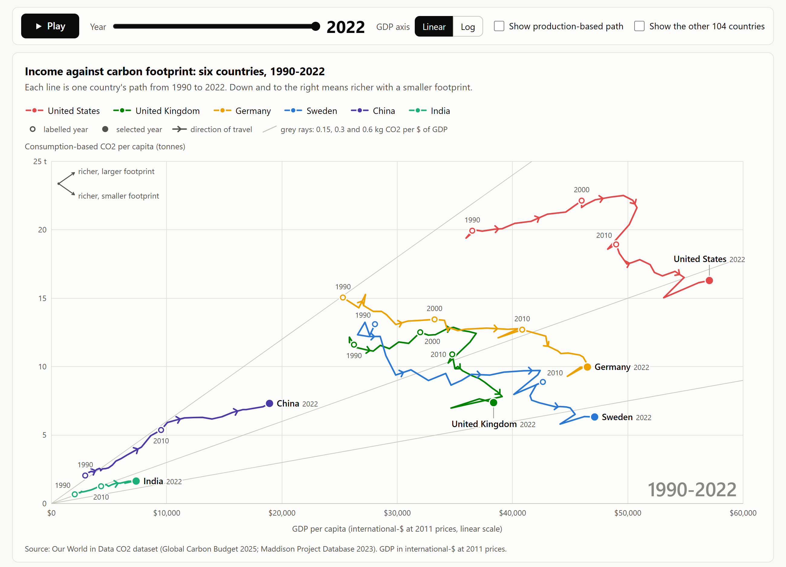

*Figure 7 - Visualization 2 at 2022, on its default linear axis. Each line is one country's path through GDP per capita (x) and consumption-based CO2 per capita (y) from 1990 to 2022. Chevrons give the direction of travel and hollow markers the years 1990, 2000 and 2010. The grey rays are constant carbon intensities of 0.15, 0.3 and 0.6 kg CO2 per dollar of GDP.*

Visualization 2 removes time from the coordinate axes so that economic output and carbon footprints can be compared directly. Real GDP per person is mapped to the horizontal axis and consumption-based CO2 per person is mapped to the vertical axis, turning each country's 33-year history into a continuous trajectory through income-emissions space from 1990 to 2022 (Figure 7). Where the original OWID line chart forced readers to mentally compare slopes across separate curves, this connected scatterplot makes the coupling relationship the geometry of the mark itself: a trajectory moving up and right indicates emissions rising with income, whereas a trajectory bending down and right demonstrates absolute decoupling.

### 4.2 Idiom, marks and channels

As Haroz et al. (2016, Section 2.1) note, the defining characteristic of a connected scatterplot is that time is encoded sequentially along a path rather than on an axis--which creates a risk that viewers will misread the direction of temporal progression if visual cues are weak. The encoding choices summarized below are designed specifically to keep directionality and scale unmistakable.

| Element | Encoding |
| :--- | :--- |
| **Item** | One country-year: 33 per country, 198 in all |
| **Mark** | A connected line per country, 2.5 px wide at desktop width |
| **Horizontal position** | GDP per person, linear from $0 to $60,000 by default; log scale on toggle |
| **Vertical position** | Consumption-based CO2 per person, linear from 0 to 25 t |
| **Order of connection** | Chronological year: vertices connected sequentially from 1990 to 2022 |
| **Direction** | Mid-segment chevrons rotated to match the screen-space angle of each path segment |
| **Time anchors** | Hollow circular markers with text labels at 1990, 2000, and 2010; solid 12 px marker at the selected year |
| **Hue** | Country identity: six distinct hues paired with direct path-end labels and a top legend |
| **Opacity** | Path segments after the selected scrubber year fade to 0.3 opacity |
| **Guides** | Three diagonal grey rays from the origin marking constant carbon intensities (0.15, 0.3, and 0.6 kg CO2 per dollar of GDP) |

**Four redundant cues for temporal direction.** Because Haroz et al. (2016, Section 7) found that single arrows are often insufficient to prevent time-reversal errors, the chart layers four distinct directional signals: mid-segment chevrons, decadal hollow anchor markers (1990, 2000, 2010), a solid terminal marker at the active year, and an interactive year scrubber. Because real GDP per capita rises in almost every year, trajectories naturally progress from left to right; the brief leftward hooks in 2009 and 2020 immediately stand out as the global financial crisis and COVID-19 recessions.

**Keeping the full trajectory visible during playback.** While an interactive play button and year slider encourage step-by-step exploration, Robertson et al. (2008) showed that animated trend displays are slower and more error-prone for analytical comparison than static traces. Accordingly, the full 1990-2022 path remains visible on screen at all times--with future years dimmed to 0.3 opacity when scrubbing--so the viewer never loses sight of the complete trajectory.

**Linear default scale with constant-intensity rays.** On a linear x-axis starting at (0, 0), the four high-income trajectories spread out clearly across the right two-thirds of the canvas, and straight lines radiating from the origin acquire a direct physical meaning: any ray of constant slope k represents a constant carbon intensity of economic output (kg CO2 per dollar of GDP). The chart draws three reference rays at 0.15, 0.30, and 0.60 kg per dollar. A path crossing clockwise into a shallower ray achieves *relative decoupling* (lower carbon intensity per dollar), whereas a path moving downward achieves *absolute decoupling* (lower total emissions per person). Toggling the x-axis to logarithmic mode bends those same constant-intensity lines into smooth curves:

```javascript
// web/d3_vis.js
              const gdp = state.scale === "linear" ? lo[0] + (lo[1] - lo[0]) * i / steps
                : lo[0] * Math.pow(lo[1] / lo[0], i / steps);
              points.push({ x: sx(gdp), y: yScale(k * gdp / 1000) });
```

**Redundant country labeling.** Distinguishing six categorical hues across intersecting lines is challenging under color vision deficiency. Using the simulation matrices of Machado et al. (2009), the three overlapping European paths (United Kingdom, Germany, Sweden) were assigned the most strongly contrasting hues, while the closest pair of hues was assigned to the United States and India at opposite corners of the canvas, reinforced by direct text labels at the end of every path.

### 4.3 What the trajectories show

**A clear mid-2000s turning point for the US and UK.** Both the United States and the United Kingdom initially travel upward and to the right: US consumption-based CO2 per person rose 13% between 1990 and its 2005 peak as GDP per person grew 36%, while UK consumption emissions rose 11% through 2004. After 2005, both trajectories bend sharply downward. Between 2007 and 2022, consumption-based CO2 per person fell by 25% in the United States, 41% in the United Kingdom, 22% in Germany, and 35% in Sweden, while per-capita GDP grew by 12%, 4%, 17%, and 11%, respectively. Unlike the US and UK, Germany and Sweden peaked in 1992 and have trended downward and to the right for three decades.

**Continuous upward coupling in China and India.** Neither China nor India exhibits a downward bend. Over the 33-year window, China's GDP per person expanded by 545% while its consumption-based CO2 per person rose 258%; India's grew by 263% and 143%, respectively. Across both economies, each 1% increase in per-capita income was accompanied by roughly 0.7% growth in per-capita consumption emissions.

**Universal relative decoupling across all six economies.** Despite diverging in absolute terms, all six trajectories cross the grey reference rays clockwise toward lower carbon intensities. In 1990, five of the six countries sat between the 0.3 and 0.6 kg per dollar rays, and China sat above the 0.6 ray at 0.70 kg per dollar. By 2022, five sit below the 0.3 kg per dollar ray and China has dropped to 0.39 kg per dollar. Over the full period, the carbon intensity of consumption fell by 71% in Sweden, 64% in Germany, 57% in the United Kingdom, 48% in the United States, 45% in China, and 33% in India.

**Inspecting the territorial-consumption gap directly on the canvas.** Checking *"Show production-based path"* overlays each country's territorial series as a thinner line and connects same-year points with a vertical gap indicator at the selected year (Figure 8, right). At 2022, this vertical gap equals +2.81 t for the United Kingdom, +2.86 t for Sweden, +2.03 t for Germany, +1.49 t for the United States, -0.90 t for China, and -0.34 t for India. Scrubbing back to 2007 highlights the United Kingdom's peak import gap of +3.34 t (Figure 9).

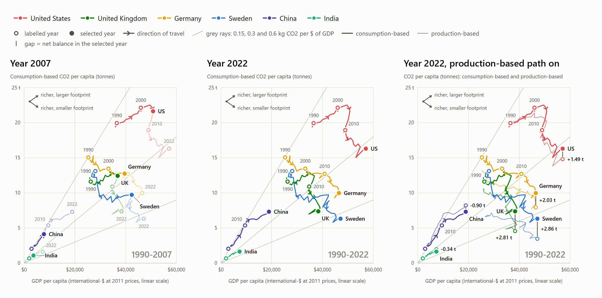

*Figure 8 - Comparison plate: three states of the chart. Left, the slider at 2007, with the later years faded. Centre, 2022. Right, 2022 with the production-based paths overlaid and each country's gap between the two accounts labelled, which is its net balance.*

### 4.4 Interaction

A unified control bar above the canvas provides six interactive affordances: a year slider with an automated Play/Pause toggle, a Linear/Log scale switcher for the GDP axis, a checkbox to overlay production-based paths, a checkbox to render the remaining 104 countries as faint grey background trajectories, clickable legend items to isolate specific countries, and four guided story steps that configure the view to illustrate key findings (Segel & Heer, 2010).

To make hovering effortless without requiring the user to land precisely on a 2.5 px path stroke, mouse position is resolved via a Delaunay triangulation (`d3.Delaunay`) computed over all visible vertices within a 30 px capture radius:

```javascript
// web/d3_vis.js
      focusIndex = focusPoints.length ? d3.Delaunay.from(focusPoints, px, py) : null;
```

Hovering highlights the active country's trajectory, dims the remaining paths, and opens a structured tooltip displaying GDP per capita, both CO2 accounts, and the net trade balance (Figure 9). Full keyboard navigation (Tab and arrow keys) and a synchronized summary table below the chart ensure accessibility.

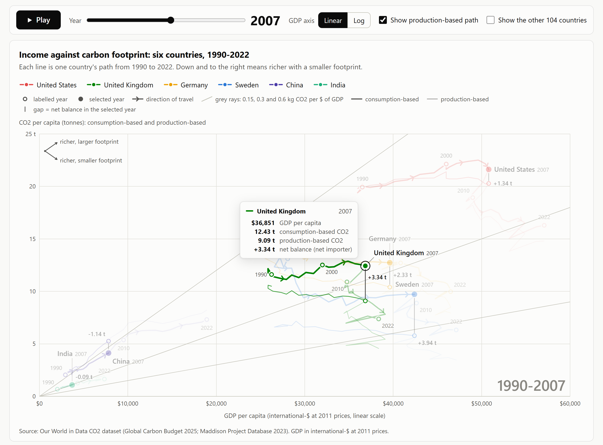

*Figure 9 - Browser capture after a real mouse move onto the United Kingdom's 2007 point, with the overlay on. The tooltip gives GDP per capita, both CO2 accounts and the net balance (+3.34 t), values first, and the other five paths dim.*

### 4.5 Implementation

The visualization is built in vanilla JavaScript on D3 v7.9 (Bostock et al., 2011) with no external framework or build step. `web/d3_vis.js` renders a responsive SVG using a `viewBox`, while `web/d3_story.js` synchronizes the UI controls, guided narrative steps, data table, and URL query parameters (`?year=2007&overlay=1`). Directional chevrons are positioned and rotated in screen coordinates after applying the active axis scales so that arrowheads remain properly tangent to the path under both linear and logarithmic views:

```javascript
// web/d3_vis.js
        const mid = { x: (pts[i].x + pts[i + 1].x) / 2, y: (pts[i].y + pts[i + 1].y) / 2 };
// ...
        out.push({ x: mid.x, y: mid.y, i: i + 0.5,
                   angle: Math.atan2(b.y - a.y, b.x - a.x) * 180 / Math.PI });
```

An automated browser check (`scripts/capture_web.py`) drives the rendered page in Microsoft Edge and verifies that all 396 plotted vertices across the consumption and production paths invert back to the source CSV values within 0.02% for GDP and 0.001 t for CO2.

**AI-use disclosure.** In accordance with the assignment guidelines allowing AI assistance on at most one visualization, this D3.js connected scatterplot was developed with AI coding assistance. I used Claude (Anthropic) as a coding partner to help implement `web/d3_vis.js` and `web/d3_story.js` from my design specification--specifically assisting with the D3 v7 SVG path rendering, screen-space chevron rotation math, Delaunay triangulation hover lookup, and control wiring. I reviewed, tested, and verified the implementation and wrote the analysis in this section independently.

Source files for this section: `web/d3_vis.js` and `web/d3_story.js`

**Source files for this section:** `web/d3_vis.js` and `web/d3_story.js`

## 5. Visualization 3 - Seaborn Diverging Trade Balance

### 5.1 The view

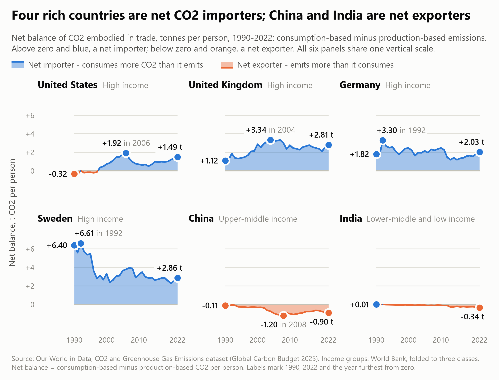

*Figure 10 - Visualization 3: net balance of CO2 embodied in trade, t per person, 1990-2022, in six facets on shared axes. Blue above zero marks a net importer and orange below zero a net exporter. Labels give the 1990 value, the 2022 value and the year furthest from zero.*

Visualization 3 isolates the exact quantity that the first two visualizations only imply: the net balance of embodied CO2 in international trade, measured in tonnes per person per year from 1990 to 2022 (Figure 10). Arranged as a 2 x 3 grid of small multiples on shared horizontal and vertical scales, each facet plots a country's consumption-minus-production difference directly against a flat zero baseline. Areas above zero are shaded blue to denote net carbon importers, while areas below zero are shaded orange to denote net exporters.

### 5.2 Idiom, marks and channels

Small multiples repeat a single visual encoding across partitioned subsets of the data on shared scales (Heer & Shneiderman, 2012, p. 50; Munzner, 2014), immediately answering Tufte's (1990, p. 67) core comparative question: *"Compared to what?"*

| Element | Encoding |
| :--- | :--- |
| **Item** | One country-year: 33 per facet, 198 in all |
| **Partition** | Country, arranged in the report's fixed order (2 rows x 3 columns) |
| **Mark** | Filled area between zero and the curve, bounded by a 2 px stroke along the series edge |
| **Horizontal position** | Year, 1990 to 2022, shared across all six facets |
| **Vertical position** | Net balance in t CO2 per person, linear, shared across all six facets with a drawn zero baseline |
| **Hue** | Sign of the balance: blue (`#2a78d6`) above zero, orange (`#eb6834`) below zero |
| **Opacity** | Fixed at 0.42 for the area fill so background gridlines remain legible |
| **Text** | Country name and income tier above each facet; direct callouts for 1990, 2022, and the peak year |

Four design choices shape how these channels work together:

**Replacing an unaligned gap judgment with position on a flat baseline.** Figure 11 illustrates why plotting the difference directly matters. In the left panel, the United Kingdom's consumption and production series are drawn as two separate downward-sloping curves; judging how the trade gap evolved requires estimating the vertical distance between two moving lines that share no common baseline--a length judgment prone to substantial perceptual error (Cleveland & McGill, 1984, p. 541). In the right panel, subtracting production from consumption places the gap on a flat horizontal zero line, turning the comparison into an immediate positional reading where the tripling of the UK import balance between 1990 (+1.12 t) and 2004 (+3.34 t) is impossible to miss.

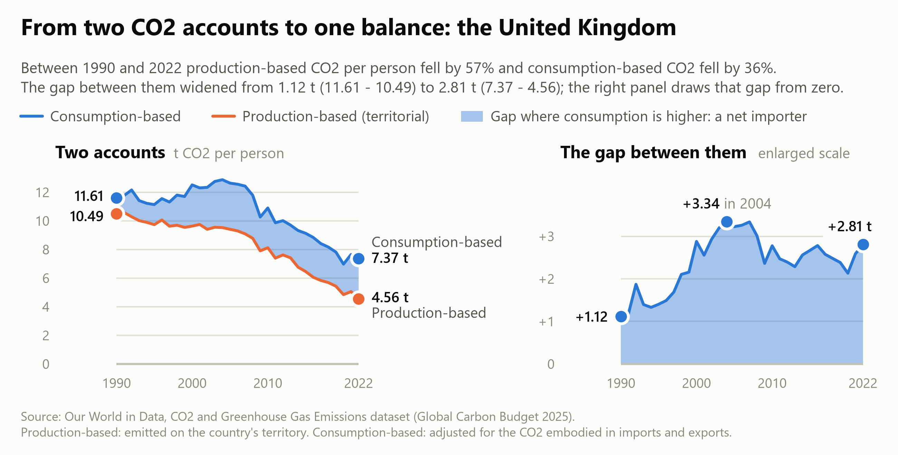

*Figure 11 - Derivation plate for the United Kingdom. Left: production-based and consumption-based CO2 per person, with the gap between them shaded. Right: the gap alone on a zero baseline, at three times the vertical scale.*

**Redundant sign encoding with diverging hue.** Because zero represents a true structural boundary between importing and exporting carbon, the chart pairs position above or below the baseline with a diverging color scheme: blue (`#2a78d6`) for net imports and orange (`#eb6834`) for net exports, matching the semantic palette used in Visualizations 1 and 2. This redundancy ensures that the sign of the trade balance can be read at a glance, remains legible if printed in greyscale, and stays clearly distinguishable under simulated protanopia and deuteranopia (Machado et al., 2009).

**Enforcing a shared vertical scale across asymmetric economies.** Locking all six facets to a common y-axis lets the reader directly compare Sweden's peak per-capita import balance (+6.61 t) against China's peak per-capita export balance (-1.20 t). The trade-off is that India's per-capita curve (+0.01 t to -0.34 t) appears nearly flat along the zero line. Retaining the shared axis is deliberate because that visual flatness communicates an important substantive finding: divided across 1.4 billion residents, India's per-capita net export balance is less than one-eighth the size of the United Kingdom's per-capita import balance.

**Focused three-point direct labeling.** Rather than cluttering the facets with dense tick labels, each panel annotates three key milestones: the 1990 starting value, the 2022 ending value, and the historical extremum furthest from zero. Where the United States crosses from net exporter to net importer between 1997 and 1998, linear interpolation splits the polygon cleanly at the exact zero crossing.

### 5.3 What it shows

**Four distinct importer trajectories.** Although all four high-income economies finish above zero in 2022, their historical paths differ sharply. The United Kingdom's net import balance tripled from +1.12 t in 1990 to +3.34 t in 2004 before easing to +2.81 t in 2022. The United States began 1990 as a slight net exporter (-0.32 t), crossed into net-importer territory in 1998, peaked at +1.92 t in 2006, and ended 2022 at +1.49 t. Germany's import balance remained remarkably stable across the three decades (+1.82 t in 1990 versus +2.03 t in 2022), whereas Sweden cut its per-capita import balance by more than half, from +6.40 t in 1990 (and a +6.61 t peak in 1992) down to +2.86 t in 2022. Meanwhile, China's per-capita export deficit deepened to -1.20 t in 2008 before narrowing to -0.90 t in 2022, while India's reached its widest point (-0.34 t) at the end of the series.

**Quantifying the reporting bias in territorial reductions.** Because net imports expanded between 1990 and 2022 in the United States, the United Kingdom, and Germany, territorial accounting overstates the reduction in their actual carbon footprints (Table 3).

| Country | Territorial CO2 per person, 1990 to 2022 | Consumption-based CO2 per person | Territorial cut minus consumption cut, points | Consumption over production, 2022 |
| :--- | :--- | :--- | :--- | :--- |
| **United States** | -26.9% | -18.3% | 8.7 | 1.10 |
| **United Kingdom** | -56.5% | -36.5% | 20.0 | 1.62 |
| **Germany** | -40.0% | -33.7% | 6.2 | 1.26 |
| **Sweden** | -48.3% | -51.7% | -3.4 | 1.83 |

The United Kingdom exhibits the largest divergence: its territorial account reports a reduction 20.0 percentage points larger than its consumption account supports, and in 2022 British consumption generated 62% more CO2 than was emitted within UK borders. Sweden illustrates the opposite dynamic: because its net import balance shrank after 1990, its consumption footprint fell faster (-51.7%) than its territorial emissions (-48.3%), even though Sweden still consumes 83% more CO2 than it emits domestically.

**Total tonnage reverses the per-capita ranking.** Evaluating the same trade balance in total million tonnes (Mt) rather than per-capita terms flips the visual hierarchy (Figure 12). Multiplied across its population, China's modest -0.90 t per-capita balance represents 1,285 Mt of net exported CO2 in 2022--exceeding the combined net imports of the United States (+511 Mt), the United Kingdom (+192 Mt), Germany (+171 Mt), and Sweden (+30 Mt) put together (903 Mt). China's aggregate export balance expanded twelvefold between 1990 (-123 Mt) and 2007 (-1,506 Mt), while India's net exports grew from near zero in 1990 to -491 Mt in 2022.

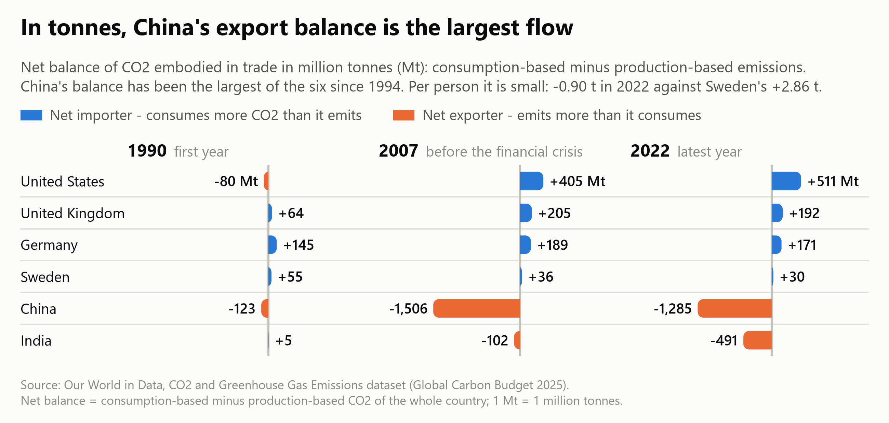

*Figure 12 - The same balance in million tonnes for 1990, 2007 and 2022. China's export balance, small per person, is the largest flow of the six in tonnes: 1,285 Mt in 2022, against 511 Mt of net imports for the United States.*

### 5.4 Implementation

The visualization is built with `seaborn` 0.13 and `matplotlib` 3.11 (Waskom, 2021; Hunter, 2007). `sns.FacetGrid` partitions the 198 focus rows across a 2 x 3 layout with shared axes and maps a custom drawing function (`facet_balance`) to each panel:

```python
# scripts/vis3_seaborn_diverging.py
    for color, name, side, keep in ((IMPORTER, "importer", 1, y >= 0),
                                    (EXPORTER, "exporter", -1, y <= 0)):
        spans = [(a, b) for a, b, s in runs if s == side]
        if not spans:
            continue
        ax.fill_between(x, 0, y, where=keep, interpolate=True, facecolor=color, alpha=FILL_ALPHA,
                        linewidth=0, zorder=2, gid=name)
        line, = ax.plot(x, y, color=color, linewidth=LINE, zorder=4, gid=name)
        line.set_clip_path(span_path(spans), ax.get_xaxis_transform())
# ...
    grid = sns.FacetGrid(data, col="country", col_order=FOCUS, col_wrap=ncol, sharex=True,
                         sharey=True, height=box["height"] / nrow,
                         aspect=(FIG_W / ncol) / (box["height"] / nrow), despine=False)
    grid.map_dataframe(facet_balance, value=VALUE, ticks=ticks, unit="t")
```

Setting `interpolate=True` in `ax.fill_between` computes the exact sub-year intersection where a series crosses zero, and clipping the boundary stroke to those same horizontal spans ensures the line and shaded polygon change color seamlessly at the zero line. The figure is rendered at 13 in width (200 dpi) for crisp typography when scaled down to the 6.5 in page column.

**AI-use disclosure.** This visualization was designed, programmed, and verified independently by me using seaborn and Matplotlib (`scripts/vis3_seaborn_diverging.py`) without AI assistance.

Source files for this section: `scripts/vis3_seaborn_diverging.py`

**Source files for this section:** `scripts/vis3_seaborn_diverging.py`

## 6. Synthesis and Answer to the Central Question

### 6.1 How the three views work together

Because no single visual encoding can simultaneously display global cross-sectional distributions, bivariate phase-space trajectories, and exact trade-gap magnitudes, each of the three visualizations addresses a distinct dimension of the research question:

- **Visualization 1 (Altair linked views)** establishes the global structure of carbon trade. Across the 110-country panel, 36 of the 46 high-income economies were net importers of embodied CO2 in 2022, with group net imports totaling 1,566 Mt (up from 372 Mt in 1990). At the same time, it refutes the notion that developing countries uniformly act as carbon exporters: 86 of the 110 countries in the panel are net importers, and just three major exporting nations (China, India, and Russia) account for 78% of all net exported CO2.
- **Visualization 2 (D3.js connected scatterplot)** pinpoints when the relationship between growth and emissions changed. Up through the mid-2000s, consumption-based CO2 per person rose alongside GDP in both the United States (+13% to 2005) and the United Kingdom (+11% to 2004). After 2007, however, all four wealthy economies bent downward into absolute decoupling--cutting consumption footprints by 22% to 41% through 2022 while continuing to expand real GDP per capita--whereas China and India climbed continuously upward and to the right across all 33 years.
- **Visualization 3 (Seaborn small multiples)** measures the exact tonnage of the trade gap between territorial and consumption accounts. It shows that the UK import balance tripled from 1.12 t per person in 1990 to 3.34 t in 2004 before stabilizing at 2.81 t in 2022, while the US shifted from a net exporter (-0.32 t) to a net importer (+1.49 t, peaking at +1.92 t in 2006).

### 6.2 The empirical answer

Both economic decoupling and carbon offshoring are real, and because the two accounting systems are linked by an exact additive identity--the reduction in consumption-based CO2 equals the reduction in territorial CO2 minus the increase in the net import balance--we can quantify the exact contribution of each (Table 4).

| Country | GDP per person | Territorial cut, t per person | Change in import balance, t | Consumption cut, t per person | Share of territorial cut offset by imports |
| :--- | :--- | :--- | :--- | :--- | :--- |
| **United States** | +56% | 5.45 | +1.81 | 3.64 | 33% |
| **United Kingdom** | +46% | 5.93 | +1.69 | 4.24 | 29% |
| **Germany** | +84% | 5.29 | +0.21 | 5.08 | 4% |
| **Sweden** | +68% | 3.24 | -3.54 | 6.78 | none: the balance shrank |

Comparing 1990 against 2022 across Table 4 provides a clear quantitative verdict. In the United Kingdom, territorial emissions fell by 5.93 t per person while a widening import balance offset 1.69 t (29%) of that gain--leaving a genuine reduction of 4.24 t per person (71% of the headline cut) in the average resident's consumption footprint. In the United States, increased carbon imports offset 33% of the territorial reduction, leaving 67% (3.64 t) as genuine consumption decoupling. In Germany, trade shifts offset just 4% of the territorial cut, and in Sweden the consumption footprint actually fell by more than twice the territorial reduction because net imports declined substantially after the early 1990s. Wealthy post-industrial economies have achieved genuine absolute decoupling, even after accounting for trade.

Three important qualifications temper this conclusion:

1. **Historical timing matters.** Between 1990 and 2007, the outsourcing critique was entirely accurate for the United Kingdom and the United States: UK territorial CO2 per person fell 13% while consumption-based CO2 rose 7%, and US territorial emissions stood flat (+0.1%) while consumption emissions climbed 8%. Had this analysis stopped in 2007, the data would have supported the outsourcing hypothesis for both Anglo-Saxon economies.
2. **Baseline levels remain understated by territorial accounting.** Even after fifteen years of falling consumption emissions, wealthy countries still consume substantially more carbon than their domestic inventories report--by 83% in Sweden, 62% in the United Kingdom, 26% in Germany, and 10% in the United States in 2022.
3. **Post-2007 UK decoupling occurred alongside weak income growth.** While UK consumption emissions dropped 41% between 2007 and 2022, Maddison real GDP per capita grew by just 4% over that entire fifteen-year span (compared to 12% in the US and 17% in Germany), meaning recent UK emissions reductions coincided with near-stagnant per-capita income.

On the exporting side, China and India achieved substantial *relative* decoupling--cutting carbon intensity per dollar of GDP by 45% and 33%, respectively--while their absolute per-capita footprints continued to grow alongside rapid industrialization and rising domestic living standards. By 2022, China's consumption footprint (7.32 t per person) had converged with the United Kingdom's (7.37 t) at roughly half the UK's per-capita GDP, and net exports accounted for 11% of China's territorial emissions (down from a peak share in 2008) and 17% of India's.

These empirical findings align closely with the broader climate-economics literature. Le Quéré et al. (2019) analyzed 18 developed economies whose emissions declined on both accounts between 2005 and 2015, showing that net emission transfers via trade plateaued around 2005. Similarly, Hubacek et al. (2021) identified 23 of 116 nations achieving absolute consumption-based decoupling between 2015 and 2018 while cautioning that short-term decoupling can reverse, and Haberl et al.'s (2020) systematic review of 835 studies concluded that while high-income nations have begun decoupling GDP from consumption-based CO2, current reduction rates remain far too gradual to meet rapid global decarbonization targets.

### 6.3 Limitations and future directions

This analysis is bounded by fossil-fuel and industrial CO2, modeled MRIO trade allocations, and single-year endpoints in the decomposition table. Extending the work would involve repeating the decomposition across multi-year averages, incorporating land-use change and non-CO2 greenhouse gases, and explicitly encoding model uncertainty bands around the post-2017 consumption estimates.

## 7. Extra Credit Summary and Web Portfolio Deployment

### 7.1 Bells and whistles completed

| Item | Points | Where | Evidence in this report |
| :--- | :--- | :--- | :--- |
| **Remixing a story** | 2 | Section 2 and all three visualizations | The original OWID article is cited, linked, and reproduced (Figure 1, Figure 2, Figure 3), critiqued across five structural limitations, and systematically addressed across the three new views (Section 2.3). |
| **View coordination** | 1 | Visualization 1 | An interactive 1D interval brush on the top time-series panel dynamically filters and re-aggregates the 109-country scatterplot below (Figure 5 and Figure 6). |
| **Live deployment** | 1 | `web/index.html`, published at https://turki-ta.github.io/cis671-data-three-ways/ | A self-contained static web portfolio hosts the narrative and all three visualizations: the interactive Altair embed, the live D3 chart, and the Seaborn small multiples (Figure 13). |

**Live Portfolio:** https://turki-ta.github.io/cis671-data-three-ways/

### 7.2 The web portfolio

The `web/` directory is a complete, zero-build static site containing all assets and data required to run the interactive story online or offline:

| File | Role |
| :--- | :--- |
| `index.html`, `styles.css` | The narrative portfolio page: central question, three visualizations, synthesis, and sources |
| `d3_vis.js`, `d3_story.js` | Visualization 2: the D3.js connected scatterplot component and interactive control wiring |
| `d3_embed.html` | Standalone D3 chart frame for iframe embedding and notebook integration |
| `altair_export.html` | Visualization 1 exported as a self-contained HTML page with Vega, Vega-Lite, and Vega-Embed inlined |
| `data/decoupling_data.js` | Preprocessed focus series (6 countries) and context series (104 countries) generated by `scripts/prepare_data.py` |
| `vendor/d3.v7.min.js` | Vendored D3 v7 library so the site makes zero external CDN requests |
| `img/vis3_seaborn_diverging.png` | High-resolution static render of Visualization 3 |

**Live Portfolio:** https://turki-ta.github.io/cis671-data-three-ways/

Because all scripts and data are bundled locally, the site runs identically from the live GitHub Pages URL, a local HTTP server, or directly from disk:

```bash
# 1. Straight from disk: double-click web/index.html
# 2. From a local HTTP server at http://localhost:8000:
python -m http.server 8000 --directory web
```

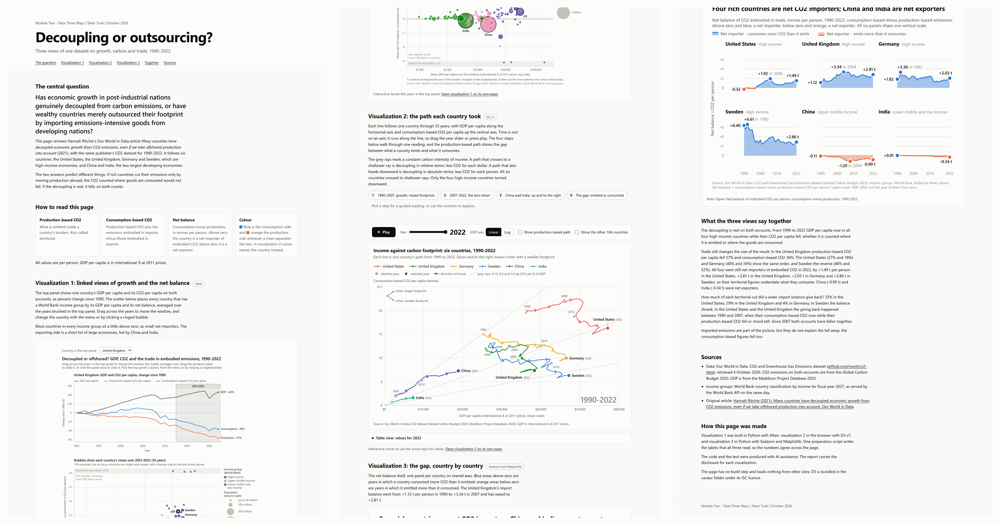

*Figure 13 - The portfolio page web/index.html, captured in full and laid out in three columns, with the top of the page at the upper left: the question, Visualization 1 embedded from its Altair export, the live D3 chart, the Seaborn figure, the synthesis and the sources.*

### 7.3 The notebook

`notebooks/module02_story.ipynb` presents the same narrative as an executable Jupyter notebook. To avoid code duplication, the notebook imports and invokes the functions in `scripts/` directly, rendering the interactive Altair chart, an inlined iframe of the D3 connected scatterplot, and the Seaborn figures in place.

### 7.4 Reproducibility pipeline

Running `python scripts/run_all.py` executes the full pipeline sequentially: verifying input file checksums, building the cleaned panel in `scripts/prepare_data.py`, generating the OWID comparison plates, rendering all three visualizations, and running an independent verification pass that recomputes every cited data value directly from the raw CSV inputs using Python's standard `csv` module to confirm exact numerical agreement.

## 8. References

Andrew, R. M., & Peters, G. P. (2025). *The Global Carbon Project's fossil CO2 emissions dataset (Version 2025v15)* [Data set]. Zenodo. https://doi.org/10.5281/zenodo.17417124

Becker, R. A., & Cleveland, W. S. (1987). Brushing scatterplots. *Technometrics*, 29(2), 127-142. https://doi.org/10.1080/00401706.1987.10488204

Bolt, J., & van Zanden, J. L. (2025). Maddison-style estimates of the evolution of the world economy: A new 2023 update. *Journal of Economic Surveys*, 39(2), 631-671. https://doi.org/10.1111/joes.12618

Bostock, M., Ogievetsky, V., & Heer, J. (2011). D3: Data-driven documents. *IEEE Transactions on Visualization and Computer Graphics*, 17(12), 2301-2309. https://doi.org/10.1109/TVCG.2011.185

Cleveland, W. S., & McGill, R. (1984). Graphical perception: Theory, experimentation, and application to the development of graphical methods. *Journal of the American Statistical Association*, 79(387), 531-554. https://doi.org/10.1080/01621459.1984.10478080

Friedlingstein, P., O'Sullivan, M., Jones, M. W., Andrew, R. M., Bakker, D. C. E., Hauck, J., Landschützer, P., Le Quéré, C., Li, H., Luijkx, I. T., Peters, G. P., Peters, W., Pongratz, J., Schwingshackl, C., Sitch, S., Canadell, J. G., Ciais, P., Aas, K., Alin, S. R., ... Zeng, J. (2026). Global Carbon Budget 2025. *Earth System Science Data*, 18(5), 3211-3288. https://doi.org/10.5194/essd-18-3211-2026

Haberl, H., Wiedenhofer, D., Virág, D., Kalt, G., Plank, B., Brockway, P., Fishman, T., Hausknost, D., Krausmann, F., Leon-Gruchalski, B., Mayer, A., Pichler, M., Schaffartzik, A., Sousa, T., Streeck, J., & Creutzig, F. (2020). A systematic review of the evidence on decoupling of GDP, resource use and GHG emissions, part II: Synthesizing the insights. *Environmental Research Letters*, 15(6), Article 065003. https://doi.org/10.1088/1748-9326/ab842a

Haroz, S., Kosara, R., & Franconeri, S. L. (2016). The connected scatterplot for presenting paired time series. *IEEE Transactions on Visualization and Computer Graphics*, 22(9), 2174-2186. https://doi.org/10.1109/TVCG.2015.2502587

Heer, J., & Shneiderman, B. (2012). Interactive dynamics for visual analysis. *Communications of the ACM*, 55(4), 45-54. https://doi.org/10.1145/2133806.2133821

Hubacek, K., Chen, X., Feng, K., Wiedmann, T., & Shan, Y. (2021). Evidence of decoupling consumption-based CO2 emissions from economic growth. *Advances in Applied Energy*, 4, Article 100074. https://doi.org/10.1016/j.adapen.2021.100074

Hunter, J. D. (2007). Matplotlib: A 2D graphics environment. *Computing in Science & Engineering*, 9(3), 90-95. https://doi.org/10.1109/MCSE.2007.55

Le Quéré, C., Korsbakken, J. I., Wilson, C., Tosun, J., Andrew, R., Andres, R. J., Canadell, J. G., Jordan, A., Peters, G. P., & van Vuuren, D. P. (2019). Drivers of declining CO2 emissions in 18 developed economies. *Nature Climate Change*, 9(3), 213-217. https://doi.org/10.1038/s41558-019-0419-7

Machado, G. M., Oliveira, M. M., & Fernandes, L. A. F. (2009). A physiologically-based model for simulation of color vision deficiency. *IEEE Transactions on Visualization and Computer Graphics*, 15(6), 1291-1298. https://doi.org/10.1109/TVCG.2009.113

Mathieu, E., & Rodés-Guirao, L. (2022, February 8). *What are the sources for Our World in Data's population estimates?* Our World in Data. https://ourworldindata.org/population-sources

Munzner, T. (2014). *Visualization analysis and design*. A K Peters/CRC Press. https://doi.org/10.1201/b17511

Peters, G. P., Minx, J. C., Weber, C. L., & Edenhofer, O. (2011). Growth in emission transfers via international trade from 1990 to 2008. *Proceedings of the National Academy of Sciences*, 108(21), 8903-8908. https://doi.org/10.1073/pnas.1006388108

Ritchie, H. (2021, December 1). *Many countries have decoupled economic growth from CO2 emissions, even if we take offshored production into account*. Our World in Data. https://ourworldindata.org/co2-gdp-decoupling

Ritchie, H., Rosado, P., & Roser, M. (2023). *CO2 and greenhouse gas emissions*. Our World in Data. https://ourworldindata.org/co2-and-greenhouse-gas-emissions

Roberts, J. C. (2007). State of the art: Coordinated & multiple views in exploratory visualization. In G. Andrienko, J. C. Roberts, & C. Weaver (Eds.), *Fifth International Conference on Coordinated and Multiple Views in Exploratory Visualization (CMV 2007)* (pp. 61-71). IEEE. https://doi.org/10.1109/CMV.2007.20

Robertson, G., Fernandez, R., Fisher, D., Lee, B., & Stasko, J. (2008). Effectiveness of animation in trend visualization. *IEEE Transactions on Visualization and Computer Graphics*, 14(6), 1325-1332. https://doi.org/10.1109/TVCG.2008.125

Satyanarayan, A., Moritz, D., Wongsuphasawat, K., & Heer, J. (2017). Vega-Lite: A grammar of interactive graphics. *IEEE Transactions on Visualization and Computer Graphics*, 23(1), 341-350. https://doi.org/10.1109/TVCG.2016.2599030

Segel, E., & Heer, J. (2010). Narrative visualization: Telling stories with data. *IEEE Transactions on Visualization and Computer Graphics*, 16(6), 1139-1148. https://doi.org/10.1109/TVCG.2010.179

Tufte, E. R. (1990). *Envisioning information*. Graphics Press.

United Nations, Department of Economic and Social Affairs, Population Division. (2024). *World population prospects 2024, online edition* [Data set]. https://population.un.org/wpp/

VanderPlas, J., Granger, B. E., Heer, J., Moritz, D., Wongsuphasawat, K., Satyanarayan, A., Lees, E., Timofeev, I., Welsh, B., & Sievert, S. (2018). Altair: Interactive statistical visualizations for Python. *Journal of Open Source Software*, 3(32), Article 1057. https://doi.org/10.21105/joss.01057

Waskom, M. L. (2021). seaborn: Statistical data visualization. *Journal of Open Source Software*, 6(60), Article 3021. https://doi.org/10.21105/joss.03021

World Bank. (2026). *FY27 updated country income classification for analytical purposes*. https://documents1.worldbank.org/curated/en/099063026190549947/pdf/BOSIB-8ff63426-3c40-412d-bad2-cc20a4ebea81.pdf
